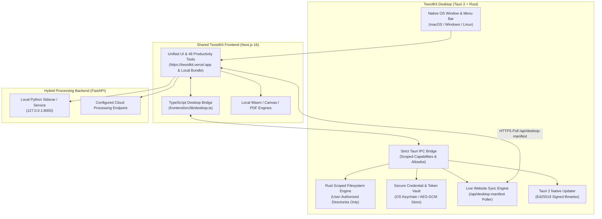

# TwoolKit Desktop — Complete Architecture & Repository Audit Report

## Phase 1: Existing Repository Audit (`aditya-misra346/TwoolKit`)

### 1. Existing Application Architecture
The **TwoolKit** repository (`https://github.com/aditya-misra346/TwoolKit`) is structured as a unified monorepo containing:
- **`frontend/`**: Next.js `16.4.4` (App Router, React `19.3.0`, TypeScript `5`, Tailwind CSS v4 via `@tailwindcss/turbopack`, Zustand `5.0.16` state management, Framer Motion `14.9.0`, Lucide icons).
- **`backend/`**: Python `3.13` FastAPI (`>=0.115`) + Uvicorn processing service (`backend/app/main.py`, `backend/app/ops.py`, `backend/app/jobs.py`, `backend/app/capabilities.py`, `backend/app/validation.py`).
- **`scripts/`**: Automation utilities (`auto_commit.sh`).
- **`docs/`**: Technical specifications (`API_CONTRACT.md` and the Desktop documentation suite).
- **Root `vercel.json` & `package.json`**: Configures Vercel deployment of the `frontend/` workspace and root npm convenience scripts.

### 2. Existing Website-to-Backend Communication
- All frontend server calls (`frontend/src/lib/api.ts`) use relative same-origin paths (`/api/health`, `/api/capabilities`, `/api/jobs`, `/api/jobs/{id}`, `/api/jobs/{id}/outputs/{index}`, `/api/jobs/{id}/cancel`).
- In local or hybrid environments, `frontend/next.config.ts` proxies `/api/:path*` to `BACKEND_URL` (defaulting to `http://127.0.0.1:8000` when not on Vercel).
- When deployed on Vercel (`https://twoolkit.vercel.app`) without an external `BACKEND_URL`, Next.js Route Handlers under `frontend/src/app/api/*` respond with client-engine capability metadata and HTTP `503` `{ fallback: true }` on `/api/jobs`, triggering automatic client-side WebAssembly/Canvas/PDF fallback in the frontend.
- Every server upload enforces explicit user consent via the `X-Cloud-Consent: granted` HTTP header (`428 Precondition Required` if not granted).

### 3. Existing Deployment Workflow
- Pushing to the `main` branch on GitHub (`https://github.com/aditya-misra346/TwoolKit`) triggers automatic production deployment of the Next.js application to Vercel (`https://twoolkit.vercel.app`).
- The Python FastAPI backend runs via `backend/run.sh` on `127.0.0.1:8000` (or a configured `BACKEND_URL` host) with isolated `0700` per-job temporary directories (`backend/var/jobs/<uuid>`) and a 60-second automatic expiration cleanup loop.

### 4. Existing Authentication & Security Mechanism
- Privacy-first consent architecture (`cloudConsent` in `useSettings`), optional Gemini API key configuration (`geminiApiKey`), and local IndexedDB storage (`idb` in `frontend/src/lib/db.ts`) for scan results, activity history, and output blobs.
- On Desktop, sensitive credentials (API keys, account session tokens, OAuth PKCE tokens) are upgraded from browser storage to the native **OS Keychain / Encrypted Credential Vault** managed by Rust (`desktop/src-tauri/src/security.rs`).

### 5. Existing File-Processing Infrastructure (48 Tools Inventory)
- **In-Browser Local Engines (`frontend/src/lib/`)**:
  - `pdfClient.ts`: `pdf-lib`, `pdfjs-dist`, `@pdfsmaller/pdf-encrypt` (AES-256), `@pdfsmaller/pdf-decrypt`, `tesseract.js` (OCR), `docx`, `exceljs`, `pptxgenjs`.
  - `imageClient.ts`: Canvas 2D, `heic-decode`, `utif2`, `upng-js`, `bmp-js`, `gifenc`, `exifr`.
  - `scanner.ts` & `fileTypes.ts`: `hash-wasm` (SHA-256), perceptual image hashing (pHash), magic-byte signature verification, security anomaly detection.
  - `archiveClient.ts`: `jszip` with Zip-Slip path traversal sanitization.
- **Python Backend Engines (`backend/app/ops.py`)**:
  - `PyMuPDF` (`fitz`), `pdf2docx`, `pikepdf`, `LibreOffice` headless (`soffice`), `Pillow` + `pillow-heif`, `python-pptx`, `python-docx`, `openpyxl`, `OpenCV` video rendering, `markdown` / `markdownify` / `xmltodict`.

### 6. Features Reused Directly vs. Native Desktop Enhancements
| Feature Area | Reused from Web Codebase | Native Desktop Enhancement (Tauri 2 + Rust) |
|---|---|---|
| **UI & 48 Tools** | 100% shared Next.js App Router views & client engines | Native window chrome, title bar, menu bar, global shortcuts (`Cmd/Ctrl+O`, `Cmd/Ctrl+,`, `Cmd/Ctrl+K`, `Cmd/Ctrl+Q`) |
| **File & Folder Access** | HTML5 `<input type="file">` & drag-drop | Native OS dialogs (`rfd` / `tauri-plugin-dialog`), native Finder/Explorer path drag-and-drop, direct output saving |
| **Storage & Folder Scanning** | Browser File System Access API | Native multi-threaded Rust directory walker with scoped folder grants, SHA-256 streaming & magic-byte inspection |
| **File Operations** | Virtual in-memory / IndexedDB | Real OS file rename, copy, move, mkdir, and confirmed Trash/delete within authorized folders |
| **Backend Processing** | Remote or manual `localhost:8000` | Automatic local Python backend health manager + configurable cloud backend + offline indicator |
| **Updates** | Vercel web deploys | **Dual-Layer Update Architecture**: Live website sync (`https://twoolkit.vercel.app`) + signed Tauri 2 native updater |

---

## Phase 2–7: Recommended & Implemented Desktop Architecture

### Dual-Layer Update & Synchronization Strategy
1. **Layer 1 — Instant Website Synchronization (Zero Reinstall)**:
   - Every Vercel deployment of `main` updates `https://twoolkit.vercel.app/api/desktop-manifest` with the current `appVersion`, `gitSha`, `buildTimestamp`, and `minDesktopVersion`.
   - TwoolKit Desktop checks `/api/desktop-manifest` on launch, on window focus, and every 5 minutes.
   - When a new compatible website deployment is detected (`minDesktopVersion <= nativeVersion`), TwoolKit Desktop waits until no active conversions are running in `useQueue`, then displays a discreet banner to hot-reload the latest production UI immediately.
   - If the user is offline, TwoolKit Desktop seamlessly serves the embedded local frontend bundle so all local tools (Scanner, PDF Merge/Split/Protect/Rotate, Image Studio, ZIP Organizer) work 100% offline.
2. **Layer 2 — Signed Native Desktop Binary Updates (`tauri-plugin-updater`)**:
   - When Rust code, Tauri capabilities, or native dependencies change, GitHub Actions builds platform installers (`.dmg`/`.app.tar.gz`, `.msi`/`.exe`, `.AppImage`/`.deb`/`.rpm`), signs them with the Ed25519 private key (`TAURI_SIGNING_PRIVATE_KEY`), and publishes `latest.json` to GitHub Releases.
   - The embedded public key in `desktop/src-tauri/tauri.conf.json` cryptographically verifies the update archive before atomic installation.
